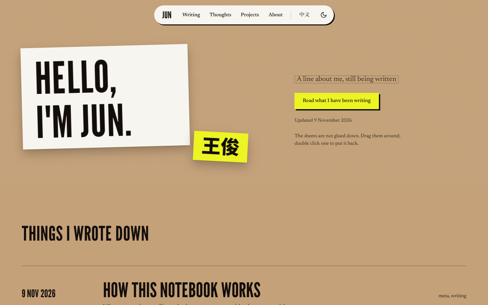

import template from './post-template.txt?url'

This first post is a manual for the site itself. Every post is one folder inside `src/content/blog/`, holding the text and everything the text uses.

## Pictures

Drop a picture into the post's folder and point at it with ordinary Markdown. The site resizes and compresses it when it builds.



## Files

Files sit in the same folder too. One import line and a `FileCard` make a download button. This is the template I copy for every new post:

<FileCard src={template} name="post-template.mdx" note="Save it as index.en.mdx or index.zh.mdx in a new folder." />

## Code

```ts
// src/site.config.ts holds everything personal
export const site = {
  name: { en: 'Jun Wang', zh: '王俊' },
  github: 'https://github.com/a6learner',
};
```

## Private notes

Anything inside `src/content/blog/private/` (or `thoughts/private/`) shows only when I run `npm run dev` on my own computer. Git ignores that folder, so it is never uploaded. A post with `draft: true` is hidden from the live site too, but its file is still uploaded, so it is not secret.
