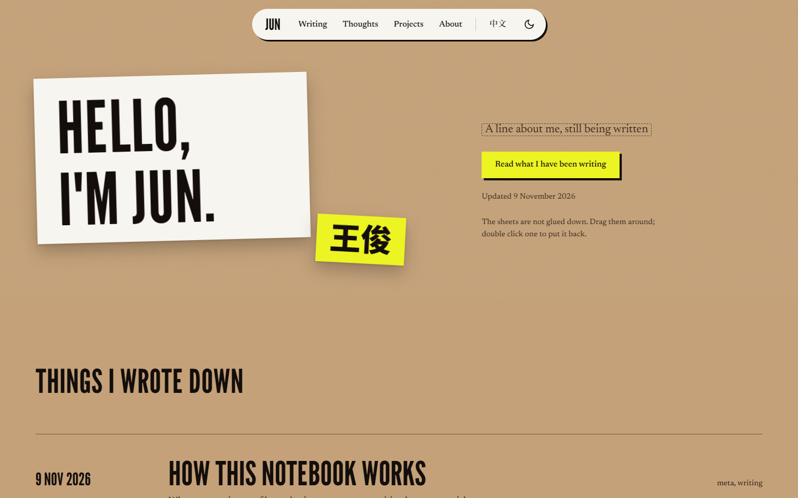

import template from './post-template.txt?url'

第一篇文章是这个网站本身的说明书。每篇文章都是 `src/content/blog/` 里的一个文件夹，里面放着正文和正文用到的一切。

## 图片

把图片放进文章的文件夹，用普通的 Markdown 引用它。网站构建时会自动缩放和压缩。



## 文件

文件也放在同一个文件夹里。一行 import 加一个 `FileCard`，就是一个下载按钮。这是我每次写新文章时复制的模板：

<FileCard src={template} name="post-template.mdx" note="在新文件夹里另存为 index.zh.mdx 或 index.en.mdx。" />

## 代码

```ts
// src/site.config.ts 里放着所有个人信息
export const site = {
  name: { en: 'Jun Wang', zh: '王俊' },
  github: 'https://github.com/a6learner',
};
```

## 私密笔记

放在 `src/content/blog/private/`（或 `thoughts/private/`）里的内容，只有我在自己电脑上运行 `npm run dev` 时才看得到。Git 会忽略这个文件夹，所以它永远不会被上传。写了 `draft: true` 的文章在线上也会隐藏，但文件本身仍会上传，所以并不保密。
